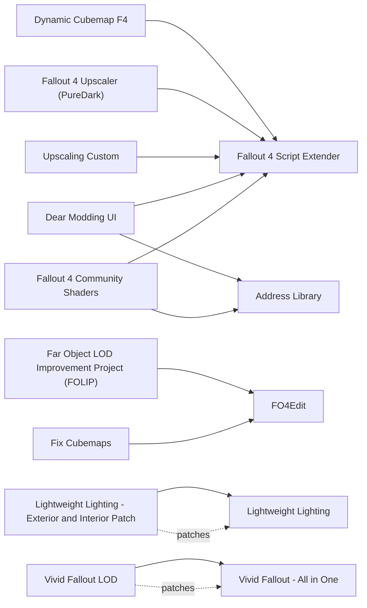

# Visuals: textures, lighting, shaders, LOD

<!-- BEGIN GENERATED: do not edit, run scripts/build_catalog.py -->
32 mods: 18 recommended, 5 optional, 9 avoid. Plugin slots if you take everything not marked avoid: 4 full.

### Recommended

| | Mod | What it does | Fit | Cost | Links |
| --- | --- | --- | --- | --- | --- |
|  | **[Fallout 4 Community Shaders](https://www.nexusmods.com/fallout4/mods/109442)** by muteptr and CS · v0.5.1 · updated 2026-11-05 · 364 endorsements · 133.4 MB | Modern lighting and shader effects (skylighting, better shadows, water, reflections), each switched on separately *0.5.1 (2026-11-05), beta; README: runtime 1.11.240 only, OG and NG code paths untested; No plugin and writes nothing to saves; Disables all its hooks and features while Motion Vector Fixes, Upscaling or Dynamic Cubemap F4 is in Data\F4SE\Plugins; do not stack it with doodlum's Frame Generation either (inference: two swap-chain proxies); Proton: put the Windows 10 d3dcompiler_47.dll in the prefix (protontricks 377160 d3dcompiler_47) and set WINEDLLOVERRIDES=d3dcompiler_47=n, CS logs a warning when Wine's builtin compiler loads; first launch compiles shaders behind the main menu; PC playthrough: test-gated, every feature off at first, then on one at a time with Boston fps checked in its Performance Overlay (Skylighting, Screen Space Shadows, Terrain Shadows, Dynamic Cubemaps, Unified Water, LOD Blending, then SSGI); Native 3440x1440 with CS TAA; its DLSS/DLAA and frame generation run through a D3D12 proxy with no Proton report for Fallout 4: test later, borderless windowed only; Feature cost is on the GPU (SSGI, Skylighting, volumetric shadows) plus some CPU for Skylighting in dense exteriors; 10 releases in 6 weeks: pin a version and re-test after each update; PC playthrough, 2026-11-07: runs under Proton 11.0-2 with d3dcompiler_47; its menu opens with End; features still to tune* | `recommended` 1.11.240: yes F4SE DLL | M3 ? PC med | needs: Fallout 4 Script Extender, Address Library conflicts: ENBSeries, Motion Vector Fixes, Upscaling, Dynamic Cubemap F4 |
|  | **[Fix Cubemaps](https://www.nexusmods.com/fallout4/mods/95531)** by DoubleYou · v1.0.2 · updated 2025-08-22 · 661 endorsements · 3 KB | Stops reflections on metal, glass and mirrors breaking at random between launches *1.0.2 (2025-08-22); FO4Edit script that rewrites cubemaps as 128 px, mipmapped and uncompressed; Run it after every texture mod is installed, install its output zip after them, re-run when a mod adds cubemaps; The Dynamic Cubemap F4 author calls it highly recommended; A Proton user reported missing reflections on mirrors, cans and robots (r/linux_gaming, 2025-09): this plausibly fixes it (unverified)* | `recommended` 1.11.240: plugin only | M3 low PC low | needs: FO4Edit |
|  | **[TMR Pre Generated Terrain LOD](https://www.nexusmods.com/fallout4/mods/67185)** by ModdingLinked · v1.0 · updated 2026-10-18 · 3,947 endorsements · 766.7 MB | Ready-made distant terrain that matches vanilla landscape textures *1.0 (2026-10-18), 731 MB of meshes and textures; Built for lists with no landscape-texture or world changes; Do not take TMR's pre-generated object LOD: our content mods differ, generate object LOD instead; Install under the LOD separator, before the xLODGen output; Which landscape textures it was built from is not documented; Fallback: no custom terrain LOD; Dropped from the PC playthrough on 2026-11-07: Vivid Fallout changes landscape textures, so Vivid Fallout LOD replaces it* | `recommended` 1.11.240: plugin only | M3 ? PC low | conflicts: Vivid Fallout LOD |
|  | **[Base Face](https://www.nexusmods.com/fallout4/mods/61836)** by SpringHeelJon · v2.2 · updated 2026-04-07 · 689 endorsements · 18.8 MB | Improved NPC face textures kept at vanilla resolution, so faces match bodies *2.2 (2026-04-07); Vanilla resolution on purpose, which avoids the dark-face bug; Exclusive with other base-face texture mods and with the Bethesda HD texture DLC (author); ESL flag not stated* | `recommended` 1.11.240: plugin only | M3 low PC low 1 full / 0 light |  |
|  | **[Enhanced Vanilla Water](https://www.nexusmods.com/fallout4/mods/97214)** by DoubleYou · v2.1 · updated 2025-10-18 · 1,506 endorsements · 34.3 MB | Better-looking vanilla water with seamless distant water *2.1 (2025-10-18), ESL-flagged ESM or ESP; Water noise with height maps for Community Shaders water parallax; Fixes a Vault 88 water seam; Precombine safety inferred from its use in TMR, which runs PRP: no author statement; A synergy patch exists for Waterworld (97251)* | `recommended` 1.11.240: plugin only | M3 ? PC low 0 full / 1 light |  |
|  | **[Fallout 4 Particle Patch](https://www.nexusmods.com/fallout4/mods/68599)** by fadingsignal · v1.3.2 · updated 2024-06-24 · 6,567 endorsements · 12.8 MB | Fog, smoke, steam and blood stop glowing in the dark, and Far Harbor fog renders further away *1.3.2 (2024-06-24), ESL-flagged ESP + BA2; Fully compatible with the Next-Gen update (author); Author: alters some effect references in the world but not precombined/previs data and needs no PRP patch, with PRP.esp loading below it; Soft-requires Gloomy Glass as a base for glass; Overlaps Enhanced Blood Textures on blood effects (let Particle Patch win); Makes Far Harbor fog removers unnecessary* | `recommended` 1.11.240: plugin only | M3 low PC low 0 full / 1 light |  |
|  | **[Far Harbor 3D Tree LODs](https://www.nexusmods.com/fallout4/mods/63191)** by DoubleYou · v3.0 · updated 2022-12-18 · 1,684 endorsements · 4.7 MB | Distant trees on Far Harbor become 3D instead of flat cards *3.0 (2022-12-18); Author: does cost a small amount of fps; Assets used by xLODGen* | `recommended` 1.11.240: plugin only | M3 ? PC low |  |
|  | **[Gloomy Glass](https://www.nexusmods.com/fallout4/mods/62518)** by SpringHeelJon · v1.2 · updated 2025-08-14 · 6,557 endorsements · 7 KB | Windows and other glass stop glowing at night *1.2 (2025-08-14), BA2 packed, ESL flagged; Material files only; Tuned for Lightweight Lighting; Fallout 4 Particle Patch uses it as its glass base; Exclusive with other glass or transparency material mods; Load before Particle Patch* | `recommended` 1.11.240: plugin only | M3 low PC low 0 full / 1 light |  |
|  | **[High Resolution Texture Pack 2K (Valius)](https://www.nexusmods.com/fallout4/mods/318)** by Valius · v1.2.5 · updated 2018-08-17 · 34,390 endorsements · 790.2 MB | Sharper 2K versions of most vanilla textures that keep the original look *1.2.5 (2018-08-17), 753 MB; Load before Targeted Textures; The 4K version costs VRAM and load time for little gain; BA2 packed before the Next-Gen archive change: expected to load on 1.11.240, not confirmed; ESL flag not stated: check in xEdit* | `recommended` 1.11.240: plugin only | M3 ? PC low 1 full / 0 light |  |
|  | **[Lightweight Lighting](https://www.nexusmods.com/fallout4/mods/57680)** by SpringHeelJon · v5.1.0 · updated 2026-09-25 · 4,850 endorsements · 20 KB | Reworked weather, sky and interior lighting with darker nights, at no frame cost *5.1.0 (2026-09-25); No scripts, no cell edits, safe to add or remove mid-save (author); PRP-compatible without a patch (author); Covers base game and DLC weathers, image spaces and lighting templates; radstorms restored in v5; TMR pick; Exclusive with any other weather or lighting-template mod (True Storms, Vivid Weathers, Darker Nights, NAC X, Far Harbor fog removers); ESL flag not stated: check in xEdit; With CS Skylighting or IBL, exposure may need a CS-side tweak* | `recommended` 1.11.240: plugin only | M3 low PC low 1 full / 0 light | patches: Lightweight Lighting - Exterior and Interior Patch conflicts: Far Harbor Fog free, Fog Harbor Lite, Ultra Interior Lighting, Ultra Exterior Lighting, Enhanced Lights and FX |
|  | **[Optimized Vanilla Tree LODs](https://www.nexusmods.com/fallout4/mods/63198)** by DoubleYou · v3.2 · updated 2024-06-10 · 1,821 endorsements · 20.8 MB | Better-looking distant trees in generated LOD *3.2 (2024-06-10); Assets used by xLODGen; plugin count not stated* | `recommended` 1.11.240: plugin only | M3 ? PC low |  |
|  | **[Targeted Textures](https://www.nexusmods.com/fallout4/mods/62958)** by SpringHeelJon · v2.5.1 · updated 2025-08-10 · 3,221 endorsements · 1740.7 MB | Fixes blurry or mis-sized textures at the right resolution for each object *2.5.1 (2025-08-10), 1.66 GB; Sized per mesh rather than blanket 4K; Designed to sit on Valius 2K: load it lower; TMR pick; Bundles Fixed Alpha Maps, No more glowing mouths and the Far Harbour pine branch fix: do not install those separately* | `recommended` 1.11.240: plugin only | M3 ? PC low 0 full / 1 light |  |
|  | **[Terrain Freckles Be Gone](https://www.nexusmods.com/fallout4/mods/99314)** by DoubleYou · v1.0 · updated 2025-12-22 · 962 endorsements · 3.1 MB | Removes the speckled noise on distant ground and hides the grass fade line *1.0 (2025-12-22), ESP + BA2; Noise and detail-normal textures only; TMR pick; ESL flag not stated* | `recommended` 1.11.240: plugin only | M3 low PC low 1 full / 0 light |  |
|  | **[This Made My Spline Stiff](https://www.nexusmods.com/fallout4/mods/98935)** by DoubleYou · v1.0 · updated 2025-12-06 · 1,286 endorsements · 0 KB | Power lines and cables stop jittering in the wind, which removes smearing under TAA and upscalers *1.0 (2025-12-06), ESL-flagged ESP; Precombine safety inferred (bendable splines are not precombined; in TMR); Exclusive with Power Line Physics; doodlum's Upscaling lists it as required to fix game bugs* | `recommended` 1.11.240: plugin only | M3 low PC low 0 full / 1 light |  |
|  | **[Vivid Fallout - All in One](https://www.nexusmods.com/fallout4/mods/25714)** by Hein84 · v2.2.3 · updated 2026-04-05 · 65,341 endorsements · 1457.3 MB | Retextured landscapes, rocks, roads and trees in one package *2.2.3, 2K file; PC playthrough: installed and tested on 1.11.240 (F4SE 0.7.9, Proton 11.0-2) on 2026-11-07; Changes landscape textures, so pre-made terrain LOD built from vanilla textures no longer matches: use Vivid Fallout LOD instead of TMR Pre Generated Terrain LOD; fps cost at 3440x1440 not measured yet* | `recommended` 1.11.240: plugin only | M3 ? PC ? | patches: Vivid Fallout LOD |
|  | **[Vivid Fallout LOD](https://www.nexusmods.com/fallout4/mods/71745)** by Hein84 · v1.3 · updated 2023-07-03 · 3,835 endorsements · 345.7 MB | Distant terrain LOD made to match Vivid Fallout's landscape textures *1.3, take the Commonwealth LOD file for the 2K Vivid textures; PC playthrough: installed and tested on 1.11.240 (F4SE 0.7.9, Proton 11.0-2) on 2026-11-07; Replaces TMR Pre Generated Terrain LOD in this playthrough; Object LOD (FOLIP and xLODGen) is generated separately and not yet done* | `recommended` 1.11.240: plugin only | M3 ? PC low | needs: Vivid Fallout - All in One conflicts: TMR Pre Generated Terrain LOD |
|  | **[FO4LODGen Resources](https://www.nexusmods.com/fallout4/mods/80276)** by Sheson · v1.2 · updated 2024-04-03 · 1,533 endorsements · 2.6 MB | LOD meshes and textures that object LOD generation draws on *1.2 (2024-04-03); All plugins are ESL-flagged (author); Only does something once you generate object LOD with xLODGen* | `recommended` 1.11.240: plugin only | M3 low PC low 0 full / 1 light |  |
|  | **[Far Object LOD Improvement Project (FOLIP)](https://www.nexusmods.com/fallout4/mods/61884)** by DoubleYou · v8.1 · updated 2026-08-16 · 4,613 endorsements · 272.9 MB | Distant buildings and objects show real detail instead of popping in *8.1 (2026-08-16); FAQ: does not break precombines; Very little performance cost (optional Force LOD8 costs a little more); Generate once the whole list is final: FOLIP script in FO4Edit (Simple Records off), then xLODGen object LOD (TMR LOD guide: atlas at max, max texture 1024, skip DLC03VRWorldspace); install the output as the last mod; re-run after any mod that adds statics; FOLIP Master.esm loads last among ESMs, the generated FOLIP - Patch.esp at the very bottom; TexGen skipped (no tree mods); a Proton report says DynDOLOD misbehaves while xLODGen works; xLODGen itself comes from the STEP forum (no Nexus page); Addictol applies FOLIP's [TerrainManager] INI values; Plugin counts not stated* | `recommended` 1.11.240: plugin only | M3 ? PC low | needs: FO4Edit |

### Optional

| | Mod | What it does | Fit | Cost | Links |
| --- | --- | --- | --- | --- | --- |
|  | **[Dear Modding UI](https://www.nexusmods.com/fallout4/mods/108874)** by Dear Modding · v0.2.2 · updated 2026-11-02 · 400 endorsements · 2.8 MB | In-game overlay menu (End key) for configuring Community Shaders and other DLL mods *0.2.2 (2026-11-02), pre-1.0; Summary says OG/NG/AE and the file postdates F4SE 0.7.9; Proton untested (requirements say Windows): if it misbehaves, configure CS by editing FO4CommunityShaders.toml; The optional Dear Modding UI - MCM bridge is experimental and needs MCM; The CS page asks for 'Dear Modding UI 2.2+', probably meaning 0.2.2* | `optional` 1.11.240: yes F4SE DLL | M3 ? PC low | needs: Fallout 4 Script Extender, Address Library |
|  | **[Better Landscape Grass](https://www.nexusmods.com/fallout4/mods/38360)** by flecked · v3.1 · updated 2023-07-20 · 4,734 endorsements · 20.1 MB | Denser, more varied grass on the landscape *3.1; PC playthrough: installed and tested on 1.11.240 (F4SE 0.7.9, Proton 11.0-2) on 2026-11-07; Grass density costs GPU time: fps not measured yet* | `optional` 1.11.240: plugin only | M3 ? PC ? |  |
|  | **[Enhanced Blood Textures](https://www.nexusmods.com/fallout4/mods/212)**  | Higher-resolution blood textures *EBT_Basic 1.01 (textures), FOMOD defaults; Plugin and cost not recorded; PC playthrough: installed 2026-11-07, first in-game session not yet checked* | `optional` 1.11.240: plugin only | M3 ? PC ? |  |
|  | **[Explosion VFX Pack](https://www.nexusmods.com/fallout4/mods/105129)**  | Replaces the visual effects of explosions *9.0.0, ESL-flagged plugin; FOMOD defaults: Standard for every explosion; Cost on the PC not measured; PC playthrough: installed 2026-11-07, first in-game session not yet checked* | `optional` 1.11.240: plugin only | M3 ? PC ? 0 full / 1 light |  |
|  | **[Lightweight Lighting - Exterior and Interior Patch](https://www.nexusmods.com/fallout4/mods/82399)** by SpringHeelJon · v1.6 · updated 2026-05-17 · 262 endorsements · 6 KB | Brighter interiors for Lightweight Lighting when dungeons feel too dark *Only if Lightweight Lighting interiors are too dark; Exact file names and plugin type not read* | `optional` 1.11.240: plugin only | M3 low PC low | needs: Lightweight Lighting |

### Avoid

| | Mod | What it does | Fit | Cost | Links |
| --- | --- | --- | --- | --- | --- |
|  | **[Dynamic Cubemap F4](https://www.nexusmods.com/fallout4/mods/108870)** by 103Sakamoto · v1.5.1.1 · updated 2026-10-22 · 310 endorsements · 0.6 MB | Live reflections on metal and glass *Community Shaders includes Dynamic Cubemaps and disables all its features while this DLL is installed; Author says it was written with ChatGPT in 3 days; Use Fix Cubemaps plus CS Dynamic Cubemaps instead* | `avoid` 1.11.240: unknown F4SE DLL | M3 ? PC ? | needs: Fallout 4 Script Extender conflicts: Fallout 4 Community Shaders |
|  | **ENBSeries**  | Graphics injector behind ENB presets (REACTOR, Spectrum, PATHOS and others) *Not on Nexus; d3d11.dll wrapper, not an F4SE plugin; Latest Fallout 4 build v0.501: water, subsurface scattering and fog do not work on the current game and the author recommends the previous game version; no 1.11.x build announced; On Proton 10/11 it crashes while compiling shaders (Skyrim SE reports), fixed only by pinning GE-Proton10-14; Community Shaders replaces it; Excluded from the PC playthrough* | `avoid` 1.11.240: unknown | M3 ? PC ? | conflicts: Fallout 4 Community Shaders |
|  | **[Fallout 4 HD Overhaul (luxor8071)](https://www.nexusmods.com/fallout4/mods/52423)** by luxor8071 · v1.3 · updated 2023-02-03 · 8,470 endorsements · 6168.4 MB | Huge texture overhaul that replaces the game's own texture archives *Replaces the vanilla BA2 files (43-65 GB): Steam file validation and every game update undo or break it; Use Valius 2K + Targeted Textures instead; Excluded from the PC playthrough* | `avoid` 1.11.240: plugin only | M3 ? PC ? | conflicts: Fallout 4 HD Overhaul 2K (luxor8071) |
|  | **[Fallout 4 HD Overhaul 2K (luxor8071)](https://www.nexusmods.com/fallout4/mods/65720)** by luxor8071 · v1.01 · updated 2025-03-13 · 6,096 endorsements · 2753.2 MB | 2K edition of the same archive-replacing texture overhaul *Replaces the vanilla BA2 files: Steam file validation and every game update undo or break it; Excluded from the PC playthrough* | `avoid` 1.11.240: plugin only | M3 ? PC ? | conflicts: Fallout 4 HD Overhaul (luxor8071) |
|  | **[Fallout 4 Upscaler (PureDark)](https://www.nexusmods.com/fallout4/mods/68586)** by PureDark · v1.0.3 · updated 2023-02-20 · 2,241 endorsements · 3.8 MB | Older DLSS upscaler built for the pre-Next-Gen game *2023-02 build, before Next-Gen; The Frame Generation page says it is not compatible with Fallout 4 Upscaler; Community Shaders covers upscaling* | `avoid` 1.11.240: **no** F4SE DLL | M3 ? PC ? | needs: Fallout 4 Script Extender conflicts: Frame Generation |
|  | **[Upscaling Custom](https://www.nexusmods.com/fallout4/mods/108772)** by Bingle · v1.72 · updated 2026-10-09 · 519 endorsements · 200.4 MB | Another DLSS/FSR upscaling and frame-generation plugin *v1.72 (2026-10-09), no runtime statement; The author says it was vibe coded; Frame generation needs Windows Hardware-accelerated GPU Scheduling (no Wine equivalent verified); Overlaps Community Shaders' upscaling* | `avoid` 1.11.240: unknown F4SE DLL | M3 ? PC ? | needs: Fallout 4 Script Extender |
|  | **[Enhanced Lights and FX](https://www.nexusmods.com/fallout4/mods/13596)** by Anamorfus · v1.0 · updated 2018-04-06 · 54,096 endorsements · 5.6 MB | Older interior and exterior lighting overhaul with new light sources *2018; Its only PRP patch (61699, 2022) dates from the PRP 74 era, and the catalogue treats PRP 74 patches as invalid on PRP 81; Lightweight Lighting covers interiors* | `avoid` 1.11.240: plugin only | M3 ? PC ? | conflicts: Lightweight Lighting |
|  | **[Ultra Exterior Lighting](https://www.nexusmods.com/fallout4/mods/41625)** by Gargorias · v1.04 · updated 2025-09-05 · 4,654 endorsements · 2.0 MB | Adds over 1,500 shadow-casting lights to exterior light sources *The Nexus Files tab lists a 1.04 upload dated 2025-09-05 as removed with the note 'This file was deleted due to malware' (file list read through the Nexus API on 2026-11-06); the remaining main file 1.04 dates from 2020; Excluded from the PC playthrough* | `avoid` 1.11.240: plugin only | M3 ? PC ? | conflicts: Lightweight Lighting |
|  | **[Ultra Interior Lighting](https://www.nexusmods.com/fallout4/mods/22101)** by gargorias · v2.3 · updated 2025-09-05 · 11,978 endorsements · 2.3 MB | Interior lighting overhaul that adds hundreds of shadow-casting lights *The Nexus Files tab lists a 2.3 upload dated 2025-09-05 as removed with the note 'This file was deleted due to malware' (file list read through the Nexus API on 2026-11-06); the remaining main file 2.3 dates from 2019; Edits interior cells and adds hundreds of shadow lights (frame cost); Lightweight Lighting covers interiors; Excluded from the PC playthrough* | `avoid` 1.11.240: plugin only | M3 ? PC ? | conflicts: Lightweight Lighting |

### Dependencies and patches

<!-- END GENERATED -->
